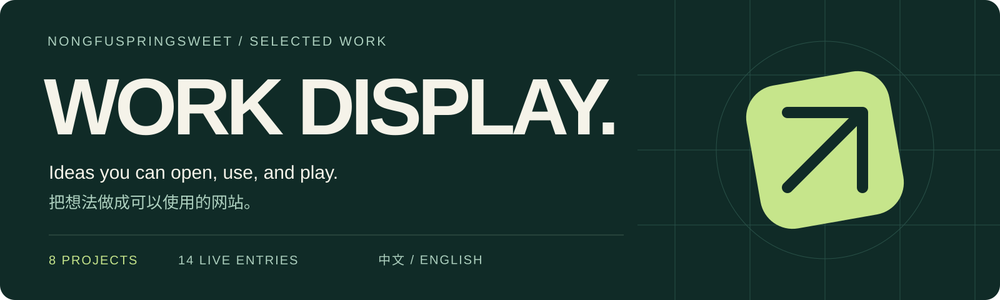

<a href="README.md">English</a> · <b>简体中文</b> · <a href="https://nongfuspringsweet.github.io/workdisplay/">网站</a>

# Work Display · 作品集

你好，我是 [NongfuSpringSweet](https://github.com/NongfuSpringSweet)。这里收集了我已上线的作品：实用工具、创作工作台、教学应用和浏览器游戏。

**欢迎关注 [X · @HuaAnDev](https://x.com/HuaAnDev)**，了解新作品、产品更新和开发记录。

**8 个项目 · 14 个网站**

## 一眼看作品

| 作品 | 做什么 | 在线体验 |
| --- | --- | --- |
| [2048 Beer](#2048-beer) | 啤酒视觉主题的 2048 合成游戏 | [2048.beer](https://2048.beer/) |
| [BingoMint](#bingomint) | 制作、设计和打印 Bingo 卡片 | [bingomint.com](https://bingomint.com/) |
| [Catalog Precheck](#catalog-precheck) | 电商商品文件预检与导入风险对比 | [catalogprecheck.com](https://catalogprecheck.com/) |
| [Mahjong Study](#mahjong-study) | 麻将教学课件、牌例与练习 | [mahjongstudy.com](https://mahjongstudy.com/) |
| [Offline Game Hub](#offline-game-hub) | 首次缓存后可以离线玩的小游戏合集 | [offlinegamehub.com](https://offlinegamehub.com/) |
| [OneImageTool](#oneimagetool) | 图片、SVG、PDF 与日常小工具 | [oneimagetool.com](https://oneimagetool.com/) |
| [PlayCards365](#playcards365) | 接龙与多种经典纸牌游戏 | [playcards365.com](https://playcards365.com/) |
| [VZTool](#vztool) | 图片创作工具与视频、图片、PDF 压缩 | [vztool.com](https://vztool.com/) |

## 2048 Beer

**把经典数字合成，做成一场有啤酒视觉风格的小游戏。**

用方向键或滑动合并相同方块，从 Fresh Pour 一路升级到 Legendary Brew。木纹桌面、酒杯插画和随数值变深的配色，让每次升级都有直观反馈。

- 提供 Standard、Classic 和 Plus 三种模式。
- 标准模式包含撤销、交换和单格清除道具；Classic 保留纯粹的合成玩法。
- 键盘和触屏均可操作，随时打开玩一局。

[在线试玩](https://2048.beer/) · [玩法说明](https://2048.beer/how-to-play)

[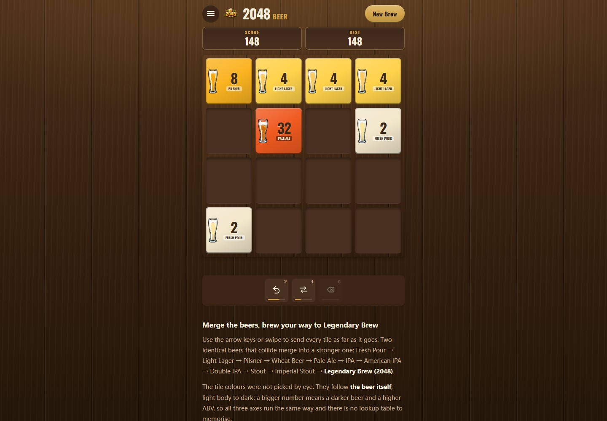](https://2048.beer/)

## BingoMint

**从一个活动点子，到一叠可以直接打印的 Bingo 卡。**

面向课堂、聚会和活动组织者的卡片制作工具。添加文字、图片和 Emoji，调整布局与样式，即时预览，再生成不同排列的卡片和打印用 PDF。

- 自定义 3×3、4×4、5×5 卡片，以及经典 30／75／80／90-ball 数字模式。
- 主题模板、自由格、卡片设计和 A4／Letter 排版。
- 支持 90-ball 六票 strip、本机保存与 JSON 备份，以及本机叫号和卡片检查。
- 基础制作和下载无需注册，界面支持多种语言。

[打开编辑器](https://bingomint.com/) · [浏览模板](https://bingomint.com/templates)

[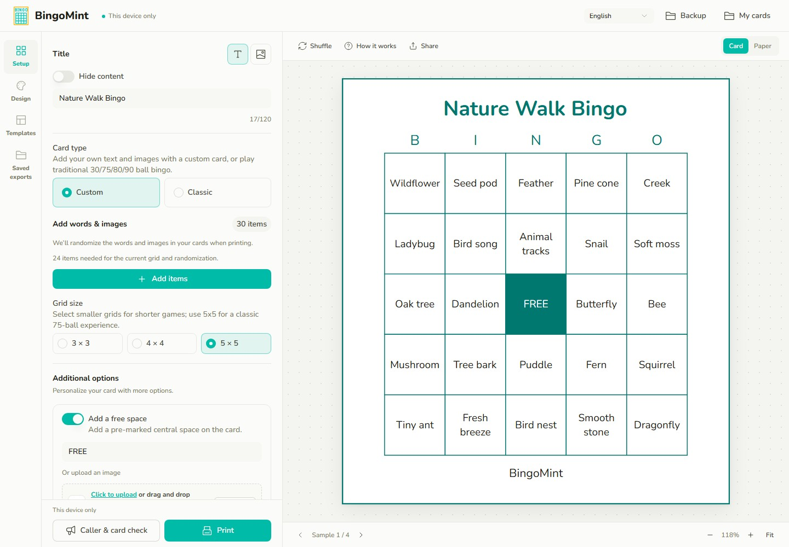](https://bingomint.com/)

## Catalog Precheck

**在导入商店之前，先看清商品文件里的问题。**

面向电商商品批量操作的文件检查工具。在浏览器中检查 Shopify CSV／XLSX 的结构、表头、商品与变体、价格及图片 URL，并把问题定位到具体记录和字段。

- Shopify 文件预检、双文件 Import Risk Compare、价格调整预览与报告。
- 提供 WooCommerce → Shopify 转换，以及 BigCommerce、Wix 和特定 TikTok Shop 模板的检查入口。
- 文件检查在本机浏览器完成；先看结果，再决定是否下载修改副本。

检查基于提供的文件和工具支持的规则，不能读取商店实际状态或保证导入结果。

[打开网站](https://catalogprecheck.com/) · [Shopify 预检](https://catalogprecheck.com/shopify-csv-validator) · [文件对比](https://catalogprecheck.com/compare)

[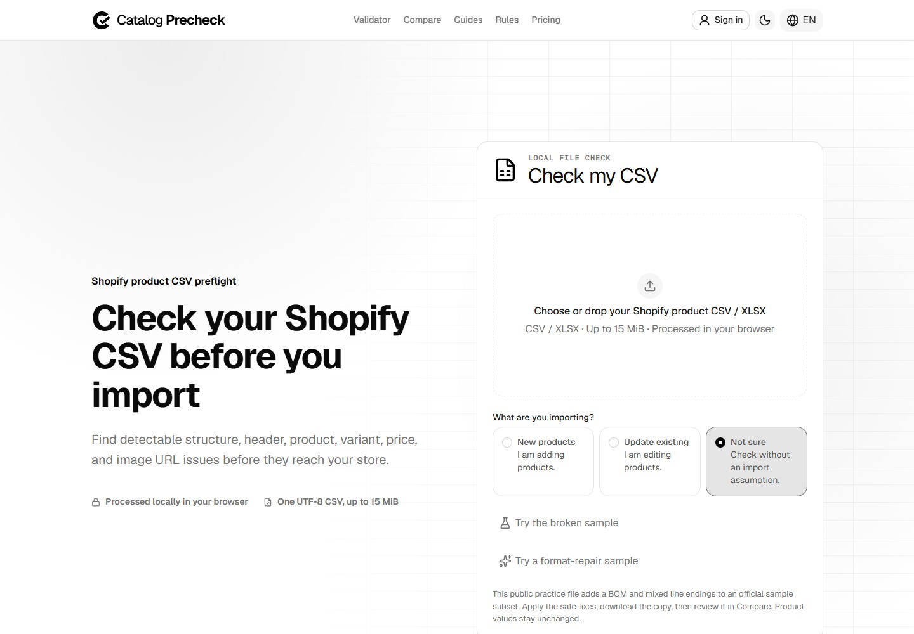](https://catalogprecheck.com/)

示例检查结果

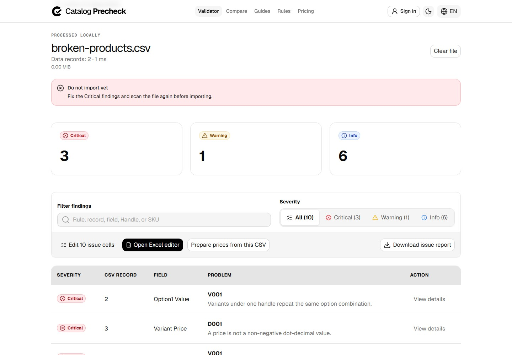

## Mahjong Study

**把一个麻将牌例，变成可以讲解、演示和带走的课程。**

面向教师和学习者的麻将教学工作台。摆放牌例、编写问题与讲解、组织教学卡片和分步演示，帮助课堂从“看牌”走向“说清楚为什么”。

- 可编辑的课件、选择题、学生预览与演示模式。
- 手牌和整桌编辑、3D 牌面查看、图片与打印输出。
- 提供规则参考与练习入口，并明确区分不同麻将玩法。
- 基础编辑无需账户，支持本机保存和 JSON 备份。

[打开教学工作台](https://mahjongstudy.com/)

[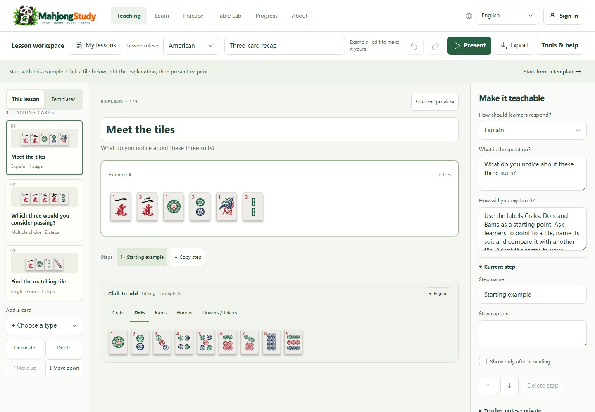](https://mahjongstudy.com/)

## Offline Game Hub

**把碎片时间留给小游戏，也让没网的时候有得玩。**

一个汇集 13 款益智、棋盘与街机小游戏的浏览器游戏站。扫雷、2048、数独、贪吃蛇、四子棋、方块、3D 魔方等，都可以从同一个入口打开。

- 分类浏览、搜索与收藏，方便找到下一款想玩的游戏。
- 部分游戏支持人机对战或同设备双人操作。
- 首次联网并缓存完成后可离线使用，成绩保存在本机；离线可用性依赖浏览器保留缓存。

[打开游戏合集](https://offlinegamehub.com/)

[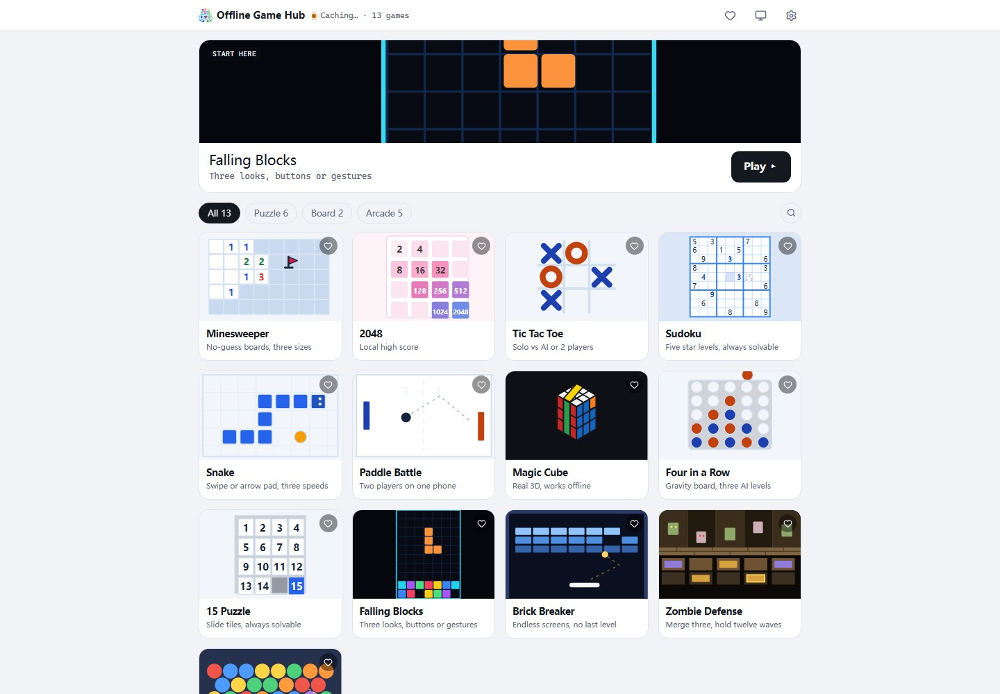](https://offlinegamehub.com/)

## OneImageTool

**日常图片任务，打开浏览器就能做。**

把图片、SVG、PDF 和常用辅助工具放到一个工作台里。压缩、格式转换、裁剪、改尺寸，以及二维码、图标等小任务，都有直接的操作入口。

- 图片压缩、转换、裁剪、水印和更多编辑工具。
- SVG 转换与优化，PDF 合并与压缩。
- 搜索与收藏、多语言界面，兼顾手机和桌面操作。
- 文件处理在浏览器中完成，常用流程无需注册。
- 部分工具现已转到专属 VZTool 工作台，包括压缩、ASCII、图标、像素画、切图与抠图。

[打开工具箱](https://oneimagetool.com/)

[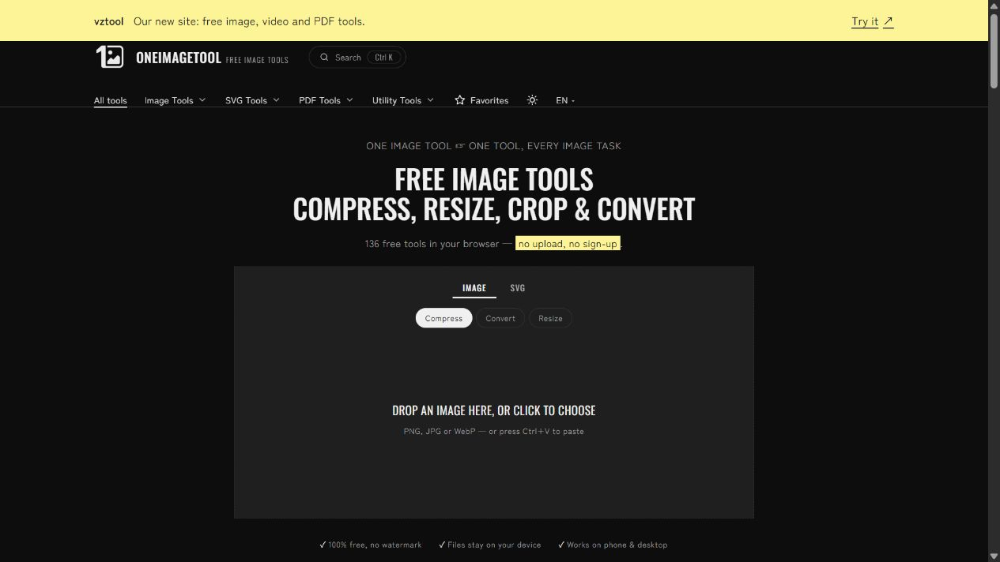](https://oneimagetool.com/)

## PlayCards365

**把熟悉的纸牌游戏，做成随时可以坐下来玩的一桌。**

提供 28 款纸牌游戏，涵盖 Klondike、Spider、FreeCell 等接龙，以及 Hearts、斗地主、Texas Hold’em 等机器人练习。绿色牌桌、清楚的卡牌和适配不同屏幕的布局，让浏览器里也有完整的牌局体验。

- 游客即可开始游戏，无需下载安装。
- 提供玩法学习入口、本机记录和自动保存。
- Hearts 与斗地主设有在线房间 Beta；其他游戏的可用模式以各页面为准。

[浏览全部游戏](https://playcards365.com/) · [开始 Klondike](https://playcards365.com/games/klondike/)

[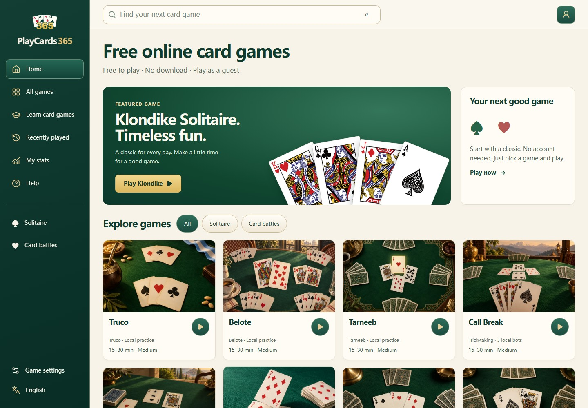](https://playcards365.com/)

Klondike 游戏画面

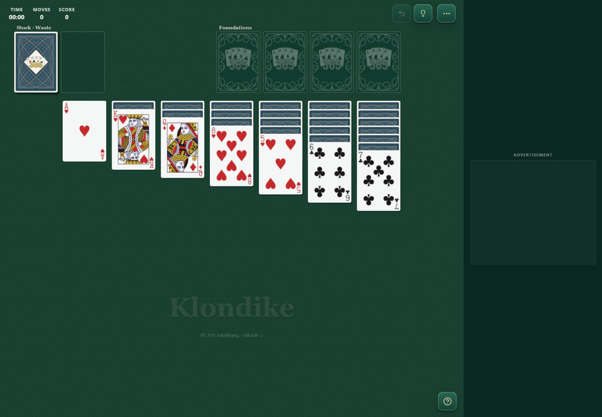

## VZTool

**Small tools, made useful. 小工具，认真做好。**

一个围绕图片创作、日常设计与文件压缩的工具系列。主站负责发现工具，6 个独立子域名分别提供专注的工作台；文件处理在本机浏览器中完成。

[打开 VZTool 主站](https://vztool.com/)

[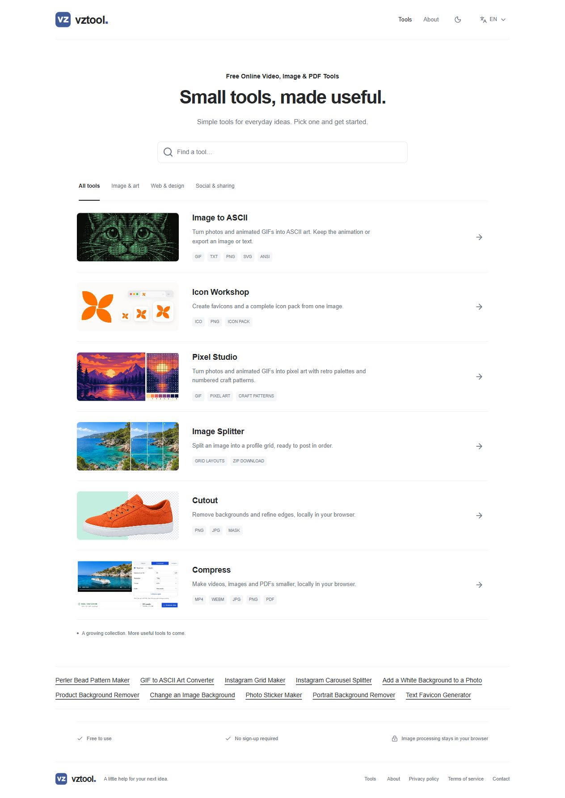](https://vztool.com/)

| 工具 | 用途 | 独立入口 |
| --- | --- | --- |
| [Image to ASCII](#image-to-ascii) | 图片和动图转字符画 | [ascii.vztool.com](https://ascii.vztool.com/) |
| [Icon Workshop](#icon-workshop) | 图片或文字生成网站图标 | [icon.vztool.com](https://icon.vztool.com/) |
| [Pixel Studio](#pixel-studio) | 像素画、像素动图与手工图样 | [pixel.vztool.com](https://pixel.vztool.com/) |
| [GridSplit](#gridsplit) | 社交媒体网格切图和发布顺序预览 | [split.vztool.com](https://split.vztool.com/) |
| [Cutout](#cutout) | AI 去背景与手动精修 | [cutout.vztool.com](https://cutout.vztool.com/) |
| [Compress](#compress) | 视频、图片与 PDF 压缩 | [compress.vztool.com](https://compress.vztool.com/) |

### Image to ASCII

把照片转成字符画，调整字符、颜色与细节，在预览中找到想要的效果。支持文字、PNG、SVG、HTML 和 ANSI 输出，适合头像、海报与终端风格创作。

GIF 和动态 WebP 可保留帧时长与循环，转换后导出 GIF；静态图片和文字输出使用首帧。

[体验 Image to ASCII](https://ascii.vztool.com/)

[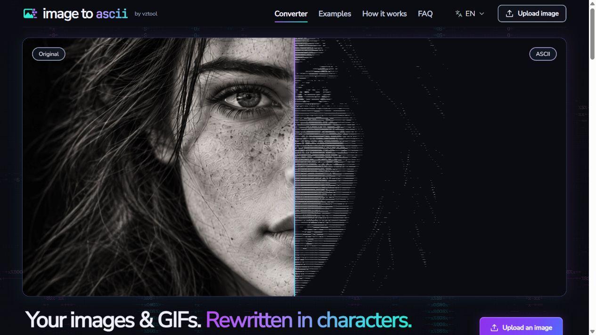](https://ascii.vztool.com/)

### Icon Workshop

从图片或文字生成网站 favicon 和应用图标。预览不同尺寸与形状，下载 ICO、PNG 或带 manifest 与安装代码的图标包，方便放进实际项目。

[体验 Icon Workshop](https://icon.vztool.com/)

[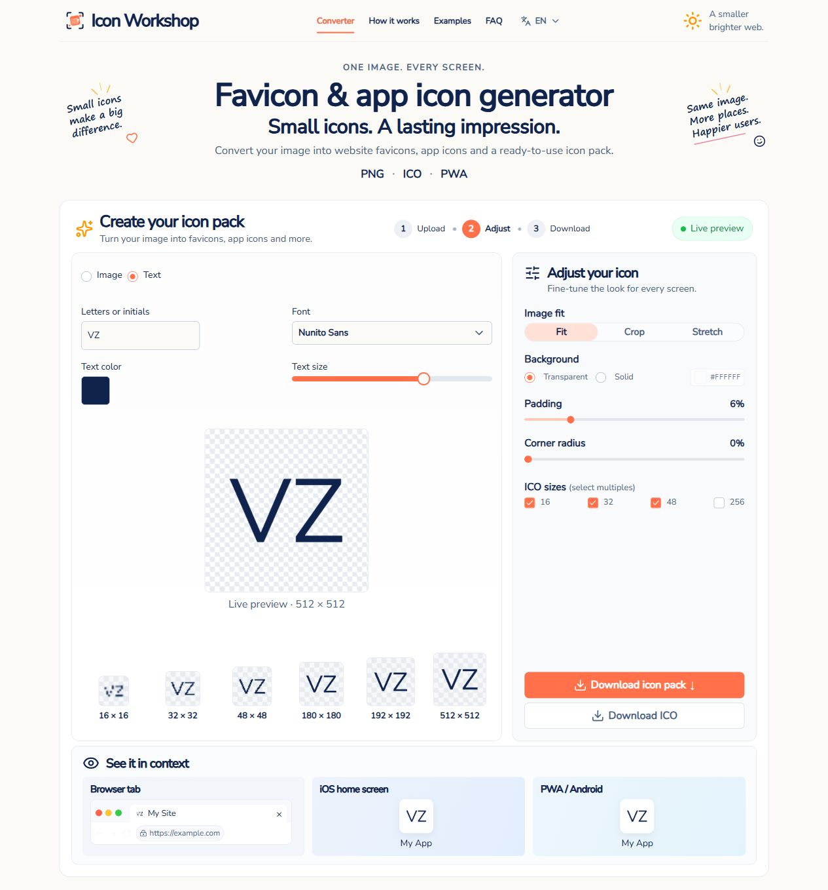](https://icon.vztool.com/)

### Pixel Studio

把照片转换为像素画，通过网格密度、颜色数量与预设调色板控制风格。既可以导出像素图，也可以生成带色号的手工参考图样。

支持 GIF 和动态 WebP 转像素动图并导出 GIF；PNG、手工图样和 ZIP 输出使用首帧。

[体验 Pixel Studio](https://pixel.vztool.com/)

[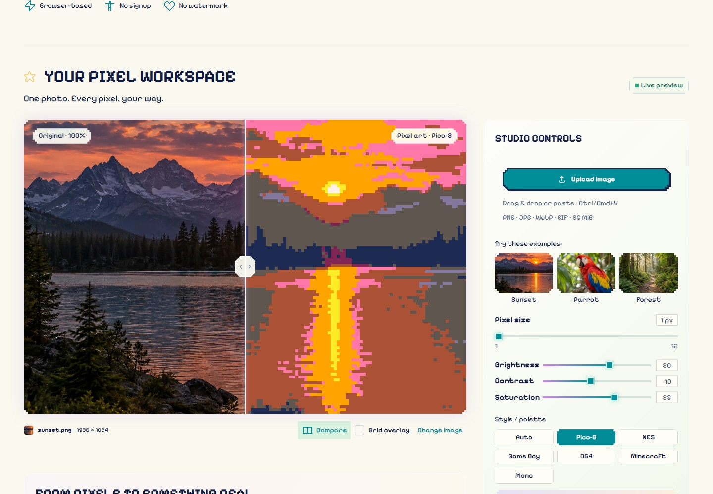](https://pixel.vztool.com/)

### GridSplit

把一张大图拆成社交媒体用的网格切片。在模拟主页中预览整体效果，查看编号与发布顺序，再打包下载切片。

[体验 GridSplit](https://split.vztool.com/)

[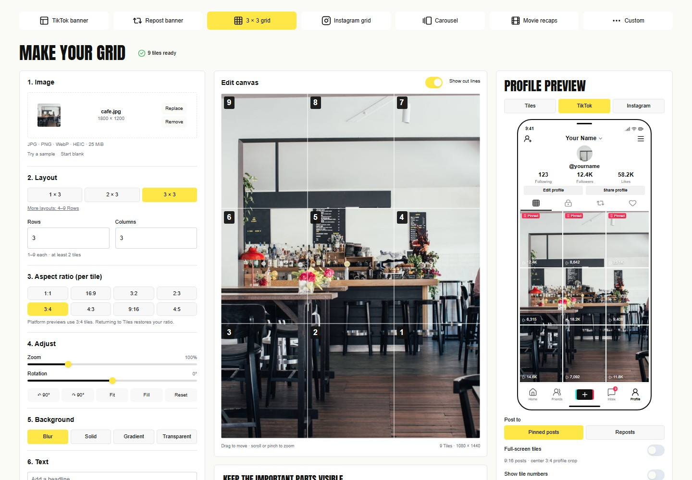](https://split.vztool.com/)

### Cutout

用 AI 自动去除图片背景，再通过套索、魔法棒和笔刷修整边缘。支持主体／背景切换、柔化、背景替换与撤销重做，最后导出透明 PNG、JPG 或遮罩。

批量抠图一次可添加最多 10 张图片，支持单独下载透明 PNG 或打包 ZIP。另有白底图、商品图、人像与贴纸的专用入口。

图片在本机处理；AI 模式首次使用需要下载模型，运行能力取决于浏览器和设备。

[体验 Cutout](https://cutout.vztool.com/)

[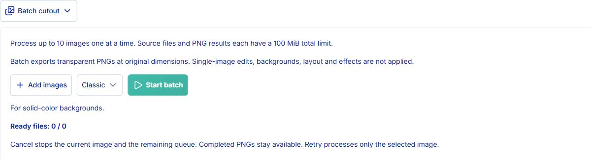](https://cutout.vztool.com/)

### Compress

**让视频、图片和 PDF 更小，文件留在自己的设备上。**

设置 KB／MB 目标大小，或按需要调整质量，对比结果后下载压缩副本。无需上传原文件，也无需注册账户。

- 视频支持 MP4、MOV、WebM 和可选片段裁剪；格式兼容性取决于浏览器。
- 图片支持 JPG、PNG、WebP 与动态 GIF，提供常用大小预设和尺寸控制。
- PDF 优化文档结构与内嵌图片，保留文字和矢量内容；不支持签名或加密文档。

输出大小与质量取决于原文件，不能保证每个文件都达到目标大小。

[压缩视频](https://compress.vztool.com/) · [压缩图片](https://compress.vztool.com/image) · [压缩 PDF](https://compress.vztool.com/pdf)

[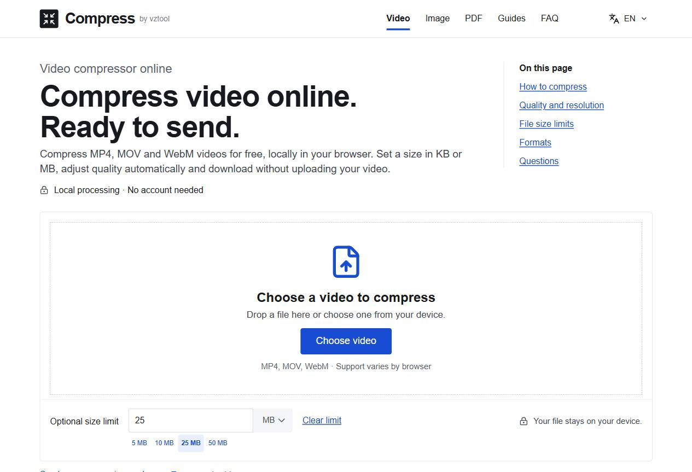](https://compress.vztool.com/)
